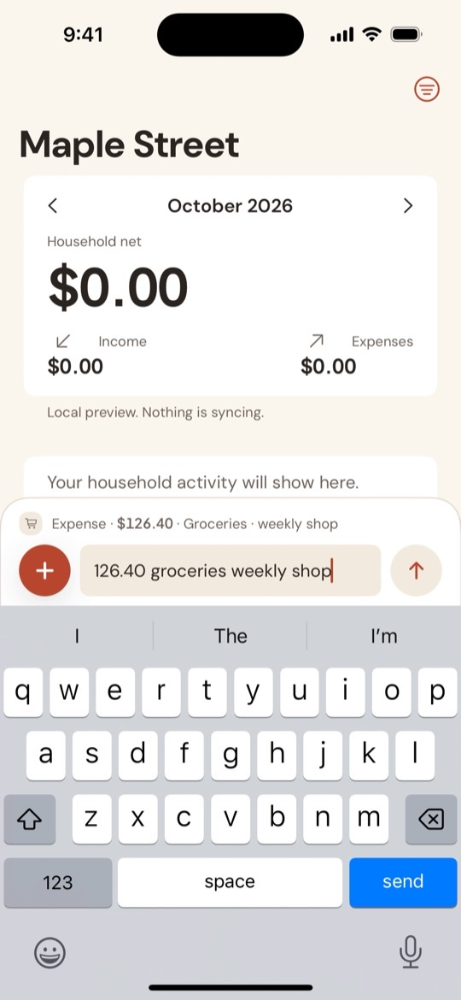
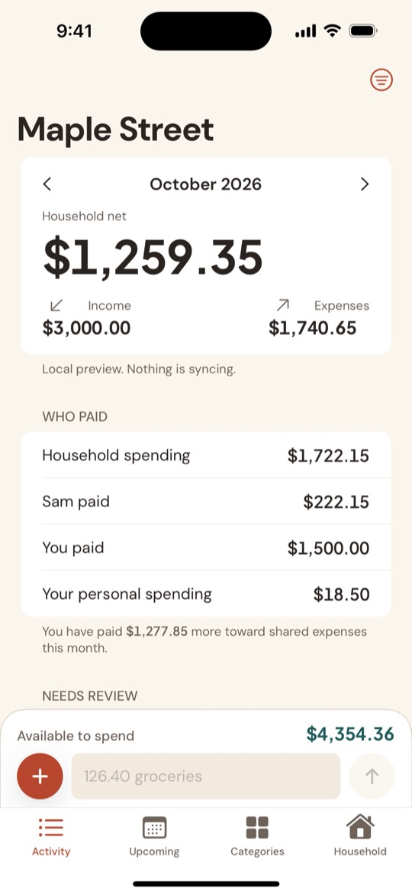
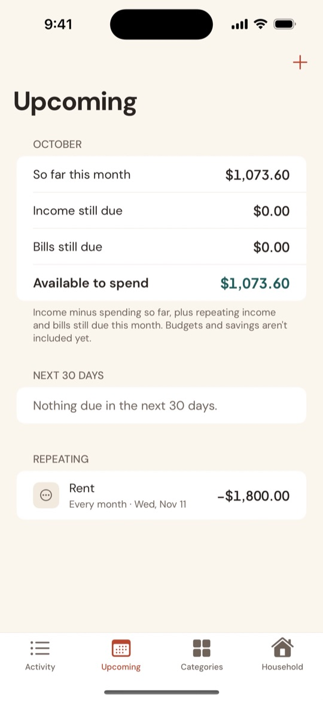

<p align="center">
  <a href="https://vishnusasikumar.github.io/huddle-site/"></a>
</p>

<h1 align="center">Huddle</h1>

<p align="center"><strong>One household. One money picture.</strong></p>

<p align="center">
  <a href="https://vishnusasikumar.github.io/huddle-site/"></a>
  <a href="https://vishnusasikumar.github.io/huddle-site/support.html#beta"></a>
</p>

Huddle is a shared money app for households. Add an expense on your phone and your partner sees it straight away. There are no bank logins and no budgeting rules to learn.

This repository holds the Huddle website, which GitHub Pages serves at **https://vishnusasikumar.github.io/huddle-site/**.

## Why Huddle

Most budgeting apps ask you to connect your bank, learn a method, or both. Often one person ends up using the app and the other stops. Huddle sticks to what matters: either of you can record what happened, and you both see the same picture.

- **Adding money feels like sending a message.** Type `126.40 groceries` and it's in.
- **You both see changes straight away.** Your partner's phone updates within moments.
- **No bank login.** You record what actually happened.
- **Neutral about spending.** An entry is information, not a grade.

## Features

| Feature | What it does |
| --- | --- |
| Household | Create a household, set its currency and invite your partner with a link. Every member is equal |
| Quick entry | Type one line, like `126.40 groceries weekly shop`, `+3000 salary` or `126.40 groceries @sam`, and Huddle reads the amount, category, note and who paid |
| Household feed | A shared feed grouped by day, filterable by category or person, with monthly net, income, expenses and "Available to spend" |
| Who paid | Each person's share of household spending, and personal spending, without saying who owes whom |
| Corrections and history | Amounts are never overwritten. Corrections and deletes stay in each entry's history, and clashing changes wait under "Needs review" |
| Repeating entries | Rent, bills and salaries added on their date. Upcoming shows the next 30 days |
| Categories | Ready-made categories, your own, and optional monthly limits |
| Privacy | Face ID, Touch ID or passcode lock, hidden in the app switcher and during screen recording, encrypted fields in iCloud, CSV export |

### Getting started

1. One person creates the household: a name, the currency and their own name.
2. They go to **Household → Invite a member** and send the link.
3. The other person opens the link, enters their name and joins.
4. Either of you adds entries from the bar at the bottom of **Activity**.

Each person needs an iPhone or iPad with iOS or iPadOS 17 or later, signed in to iCloud with their own Apple Account. The full walkthrough is on the [Get started](https://vishnusasikumar.github.io/huddle-site/guide.html) page.

### Privacy

Huddle has no servers of its own. A household lives in the iCloud account of the person who created it and is shared only with the people they invite. Amounts, notes and names are stored as iCloud encrypted fields. There are no ads, analytics or tracking. Huddle doesn't call itself end-to-end encrypted; the [Security](https://vishnusasikumar.github.io/huddle-site/security.html) page lists exactly what is and isn't encrypted.

### Pricing

- **Free:** one household of two, with the shared feed, quick entry, categories, repeating entries, history and export. The shared feed will always be free.
- **Household+:** US$1.99 a month or US$14.99 a year to invite more than two members. Paid by the household's owner and shared through Family Sharing. Free during the beta.

### Roadmap

- **Coming next:** settle up (who owes whom), safe to spend, notifications and money moments, receipt photos, a Mac app.
- **Later:** shared goals, cash-flow forecasts, Android and web, family mode.

### See it

A three-minute [walkthrough video](https://vishnusasikumar.github.io/huddle-site/index.html#tour) shows setup, quick entry, repeating entries, corrections and the Household tab.

<p align="center">
  
  
  
</p>

## The site

| Page | Live URL |
| --- | --- |
| Home | https://vishnusasikumar.github.io/huddle-site/ |
| Features | https://vishnusasikumar.github.io/huddle-site/features.html |
| Get started | https://vishnusasikumar.github.io/huddle-site/guide.html |
| Security | https://vishnusasikumar.github.io/huddle-site/security.html |
| Support | https://vishnusasikumar.github.io/huddle-site/support.html |
| Privacy policy | https://vishnusasikumar.github.io/huddle-site/privacy.html |

App Store Connect uses the Home, Support and Privacy policy URLs as Huddle's marketing, support and privacy policy links. Keep those paths stable.

## What's inside

```
index.html      Home: the pitch, how it works, quick entry, privacy, pricing
features.html   Every feature in the current build, plus the roadmap
guide.html      Setup walkthrough and everyday use
security.html   What Huddle protects, from whom, and what it doesn't
support.html    FAQs, contact details and how to join the beta
privacy.html    Privacy policy
style.css       Shared styles and Huddle design tokens (light and dark)
images/         App screenshots (540 × 1170 JPEGs) used on Home, Features and Get started
media/          The walkthrough video, its poster frame and the beta guide PDF
icon.svg        App icon, also used as the favicon
.nojekyll       Tells GitHub Pages to serve files as they are
```

It's plain HTML and CSS, with no build step and no JavaScript. The video is about 27 MB and loads only when someone presses play. Each page carries its own copy of the header and footer, so a new page means adding its link to the nav and footer of every page.

### Where the content comes from

The site follows the docs in the [Huddle app repository](https://github.com/vishnusasikumar/Huddle). When the app changes, update the matching page. Paths are relative to the app repository:

| Page | Source |
| --- | --- |
| Home, Features | The app's `README.md` and `docs/product/BACKLOG.md` (pricing, roadmap) |
| Get started | `docs/beta/guide.html` |
| Screenshots, video, beta guide PDF | `dist/walkthrough-media/` and `dist/beta-v<version>/`, built by `docs/beta/build-package.py` |
| Support: Join the beta | `docs/beta/what-to-test.txt` |
| Security, Privacy policy | `docs/engineering/THREAT_MODEL.md`. Neither page may claim more than it does |
| Wording | `docs/brand/VOICE.md` |

## Brand

The site follows the Huddle design system: warm paper and ink, terracotta for the brand, and teal for accents.

| Token | Light | Dark |
| --- | --- | --- |
| Brand | `#B9472F` | `#E58467` |
| Accent | `#1F5C5B` | `#7FBFB2` |
| Surface | `#FBF6EF` | `#1B1714` |
| Ink | `#2A2420` | `#F4ECE3` |

Body text is set in DM Sans and amounts in Plus Jakarta Sans, both from Google Fonts. All tokens live at the top of `style.css`.

## Preview locally

```sh
python3 -m http.server 8000
```

Then open http://localhost:8000.

## Publishing

Pushing to `main` updates the live site within a minute or two. Pages deploys from the root of the `main` branch.

When Huddle launches on the App Store, point the "Join the beta" button in `index.html` at the App Store and change the "Coming soon" line under it. Update the TestFlight wording on the Get started and Support pages too. When the app's screens change, rebuild the beta package and copy the new stills, video and PDF into `images/` and `media/`. If anything changes about how Huddle handles data, update `privacy.html` and its effective date, and `security.html`.

## Contact

For help with the app, see the [support page](https://vishnusasikumar.github.io/huddle-site/support.html) or email vvssoftwaresolutionslimited@gmail.com.

---

<sub>© 2026 VVS Software Solutions Ltd. All rights reserved.</sub>
