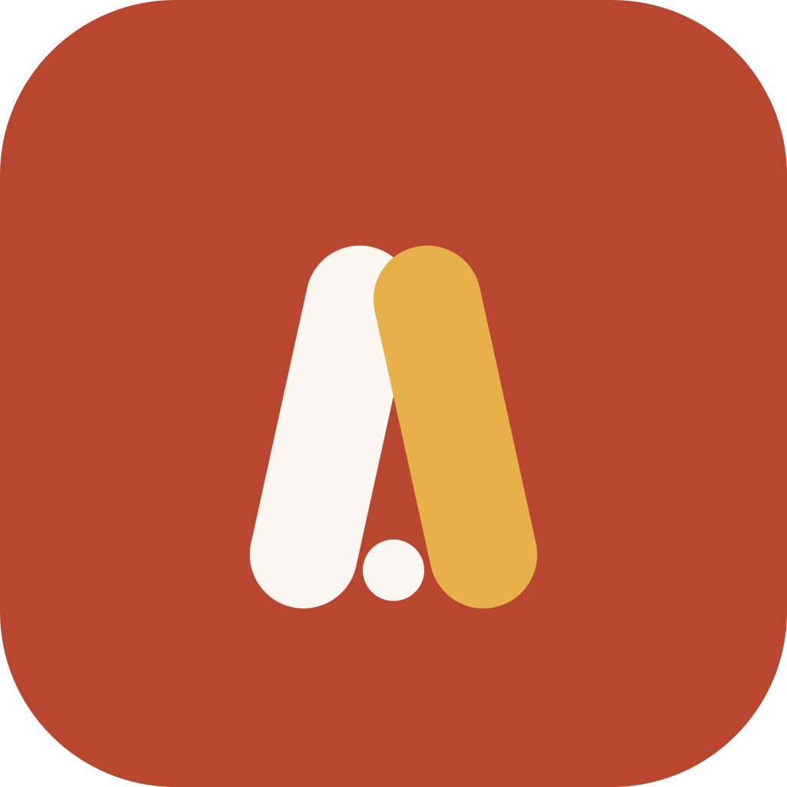

<p align="center">
  <a href="https://vishnusasikumar.github.io/huddle-site/"></a>
</p>

<h1 align="center">Huddle</h1>

<p align="center"><strong>One household. One money picture.</strong></p>

<p align="center">
  <a href="https://vishnusasikumar.github.io/huddle-site/"></a>
  <a href="https://vishnusasikumar.github.io/huddle-site/support.html#beta"></a>
</p>

Huddle is a shared money app for households. Add an expense on your phone and your partner sees it straight away. There are no bank logins and no budgeting rules to learn.

This repository holds the Huddle website: the landing page, the support page and the privacy policy. GitHub Pages serves it.

## The site

| Page | Live URL |
| --- | --- |
| Home | https://vishnusasikumar.github.io/huddle-site/ |
| Support | https://vishnusasikumar.github.io/huddle-site/support.html |
| Privacy policy | https://vishnusasikumar.github.io/huddle-site/privacy.html |

App Store Connect uses these URLs as Huddle's marketing, support and privacy policy links. Keep the paths stable.

## What's inside

```
index.html     Landing page
support.html   FAQs, contact details and how to join the beta
privacy.html   Privacy policy
style.css      Shared styles and Huddle design tokens (light and dark)
icon.svg       App icon, also used as the favicon
.nojekyll      Tells GitHub Pages to serve files as they are
```

It's plain HTML and CSS, with no build step and no JavaScript.

## Brand

The site follows the Huddle design system: warm paper and ink, terracotta for the brand, and teal for accents.

| Token | Light | Dark |
| --- | --- | --- |
| Brand | `#B9472F` | `#E58467` |
| Accent | `#1F5C5B` | `#7FBFB2` |
| Surface | `#FBF6EF` | `#1B1714` |
| Ink | `#2A2420` | `#F4ECE3` |

Body text is set in DM Sans and amounts in Plus Jakarta Sans, both from Google Fonts. All tokens live at the top of `style.css`.

## Preview locally

```sh
python3 -m http.server 8000
```

Then open http://localhost:8000.

## Publishing

Pushing to `main` updates the live site within a minute or two. Pages deploys from the root of the `main` branch.

When Huddle launches on the App Store, change the "Coming soon to the App Store" button in `index.html` to the App Store link. If anything changes about how Huddle handles data, update `privacy.html` and its effective date.

## Contact

For help with the app, see the [support page](https://vishnusasikumar.github.io/huddle-site/support.html) or email vvssoftwaresolutionslimited@gmail.com.

---

<sub>© 2026 VVS Software Solutions Ltd. All rights reserved.</sub>
